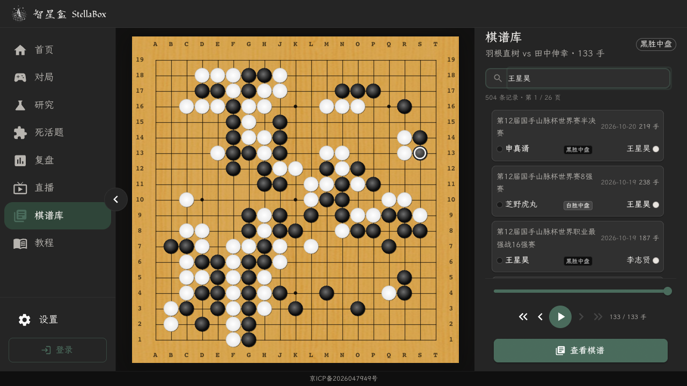

# Galaxy 正式棋谱库搜索性能调查

日期：2026-10-26；采测窗口约 08:02–08:22 UTC / 16:02–16:22 北京时间。范围为正式站 [Galaxy 棋谱库](https://modelstella.com/galaxy/kifu)，姓名为 **王星昊**。

本轮仅调查和提出方案：没有生产 DDL、业务写入、缓存清理、数据库迁移、服务重启、模型调用或新增导入。生产探针均为公开棋谱 SELECT；SQL 探针使用 `READ ONLY`、`statement_timeout=3s`、`lock_timeout=500ms` 和进程时间预算。没有压测生产。自然 hourly writer 当时运行；已与独立 hourly 修复任务协调人工维护窗口。以下数字是该窗口样本，不能当作长期 SLA。

## 结论

1. **当前数据库是同机 Docker 网络上的 PostgreSQL 15.18。17.7 万谱的棋手筛选本身很快；慢在名称审核证据读取。** 王星昊已解析为 `player_id=25`，COUNT 4.4ms、20 条分页 3.4ms；同一次 API 却约 2.46s。主要耗时是 62 万行名称变更历史表的反复扫描，以及 26 万行原始赛事名称表上的零匹配姓名查询。
2. **重搜没有稳定解决速度。** 实际生产 HTTP 搜索 5 次仍为 2.17–2.51s；浏览器 Enter 到新列表约 2.27s。原截图那一次没有足够请求耗时日志，不能断言是某个超时、缓存或 writer 造成。
3. **“看起来不相关”另有一个可以复现的界面问题。** 右侧已是王星昊的 504 条结果，左棋盘与标题仍显示上一次无条件列表的“羽根直树 vs 田中伸幸”。搜索后没有重置不在新列表中的 `selectedId`。这不等于数据库返回了不相关的棋谱。
4. **最小方向是优化现有 PostgreSQL 的两个访问路径，再减少重复证据校验，修正前端选择状态。** 没有证据要求迁到 HBase，也没有证据证明必须上 Redis。索引方案尚未执行，不能承诺仅建索引就能达到 200ms。

## 实际部署与数据规模

| 项目 | 现场结果 |
|---|---|
| 正式 Web | `ucloud-v100` / `katrain-ucloud-katrain-web-1` |
| 采测代码来源 | OCI revision `93f2038a0020d43b3090b1a71c8877980580f740`，image `katrain-rank-release:kifu-ranks-93f2038a0020-web` |
| DB dialect / version | `postgresql` / PostgreSQL 15.18 Alpine |
| DB 网络 | Web `172.19.0.5` → Docker alias `postgres:5432` → `katrain-ucloud-postgres-1` `172.19.0.2`；没有跨云 DB 跳转 |
| DB 名 | `katrain_prod_20260725`；没有记录或输出密码/连接 URL |
| 全库大小 | 4,962,245,991 bytes，约 4.62GiB，包含其他应用表 |
| 棋谱物理 / 可见数 | 176,881 / 176,622；可见条件为无 duplicate、无 hidden reason |
| `kifu_albums` 大小 | heap 1,027,366,912 bytes；含索引/TOAST 1,156,644,864 bytes |
| 名称历史 | `kifu_name_changes` 约 622,538 行，含索引约 1.07GB；行数来自统计，非另做全表 COUNT |
| 原始赛事名称 | `kifu_raw_event_names` 约 259,714 行，约 61MB |
| 名称审核批次 | `kifu_name_batches` 约 913 行，含 TOAST/索引约 312MB，说明单批次审核 JSON 较大 |
| 资源快照 | Web 276MiB / 4GiB；DB 1.56GiB / 2GiB；单次 `docker stats` CPU 各约 1%，不代表峰值 |
| PG 配置 | `shared_buffers=128MiB`，`work_mem=4MiB`，`max_connections=100`，`track_io_timing=off` |
| SQLAlchemy 配置 | pool_size 20 / max_overflow 40 / pre_ping；现场连接活动快照只有 1–2 个 active、约 10 个 idle、2 个 idle-in-transaction，没有当时连接耗尽证据 |

证据：[DB 元信息](evidence/2026-10-26-galaxy-kifu-search/db-metadata.jsonl)、[执行计划及表统计](evidence/2026-10-26-galaxy-kifu-search/explain-analyze.jsonl)。客户端是正常云服务模式，没有走棋盘 remote repository dispatcher；本路由没有 Redis 查询或 HTTP 结果缓存。

调查 worktree 最终跟到 `origin/develop` `4691484225b47fca7c6c7f8c8faa6edf6426a23d`；这期间新增的 Kiosk 首页图标改动不改变下述搜索源码。生产调查仍以上述 93f 来源为准。

## 请求链与实测基线

真实请求：

```text
GET /api/v1/kifu/albums?q=王星昊&page=1&page_size=20&lang=cn
```

它返回 **20 条摘要 + 精确总数 504 + 第一条 SGF 预览**，响应 15,651 bytes。不是把该棋手全部 504 份 SGF 一次下载，更不是下载整个 17.7 万谱库。五语姓名先通过已批准名称识别归一到棋手 ID；随后按黑/白棋手 ID 或匹配后的 raw scope 筛选。非精确命中路径才可能落到 `search_text LIKE '%q%'`、lower(player) contains 和多项 OR。本次王星昊走精确 ID 路径。

| 边界 | 样本 / 结果 |
|---|---|
| 本机公网 curl #1 | HTTP 200；DNS 7.6ms，TCP 累计 1010.4ms，TLS 累计 1045.6ms，TTFB 3554.3ms，总 3555.0ms |
| 本机公网 curl #2 | HTTP 200；DNS 1708.0ms，TLS 累计 1748.4ms，TTFB 4701.2ms，总 4701.8ms |
| PROD 容器 loopback，真实 HTTP 搜索 | 2172.190 / 2508.500 / 2422.844 / 2279.381 / 2324.660ms；p50 **2324.660ms**，n=5 的 nearest-rank p95=2508.500ms |
| PROD 容器 loopback，无搜索首页 | 4420.977 / 4413.719 / 4355.009ms；p50 **4413.719ms**，n=3 的 p95=4420.977ms |
| 正式浏览器，初次无条件列表 resource | 4808.3ms |
| 正式浏览器 Enter → 新列表 DOM 可见 | **2267.7ms**；API resource 2229.0ms；Enter→发请求约 14.5ms；responseEnd→列表 DOM约 **24.2ms** |

公网 curl 采用独立连接，DNS/建连明显波动，不能把这些网络时间当作数据库时间。浏览器样本直接访问正式域名，连接已可复用。DOM 可见时刻由 MutationObserver 记录，表示列表文字已提交到 DOM，**不等于已测量到最终合成帧或用户设备绘制时间**。小样本 p95 只是样本分位数，不能证明线上总体 p95。

证据：[真实 HTTP 基线](evidence/2026-10-26-galaxy-kifu-search/http-loopback-baseline.jsonl)、[浏览器分段计时](evidence/2026-10-26-galaxy-kifu-search/browser-timing.json)。

Galaxy 本页由 **Enter 提交**，搜索图标只是装饰，本页**没有 debounce**。`fetchData` effect 的 cancelled 标记能阻止旧列表响应覆盖新状态，但没有向 fetch 传 AbortSignal，旧请求仍会消耗服务器资源。相同 q 再按 Enter 通常不会改变 effect 依赖，不能把“第二次按搜索”视为可靠的强制重试。若用户只点了装饰图标，当前实现也不会触发搜索，这是交互提示应改善之处；没有据此猜测用户原先如何操作。

后端一次串行完成：姓名识别 → 赛事选择验证 → COUNT → 当前页记录 → 展示名称及证据验证 → 分析报告可用性 → 当前页 rank snapshot → 响应。第一页 SGF 已随列表返回并进入前端 10s preview Map，正常自动预览不需要再串行请求 detail；本次浏览器 resource 中也只有列表请求。全部 20 行 SGF 在服务端已加载以校验 report availability，但未把全部 20 份 SGF 输出给客户端。

源码：[搜索 API](https://github.com/shevapato2008/katrain/blob/93f2038a0020d43b3090b1a71c8877980580f740/katrain/web/api/v1/endpoints/kifu.py#L262)、[Galaxy 搜索和选择状态](https://github.com/shevapato2008/katrain/blob/93f2038a0020d43b3090b1a71c8877980580f740/katrain/web/ui/src/galaxy/pages/KifuLibraryPage.tsx#L273)、[前端 API/预览复用](https://github.com/shevapato2008/katrain/blob/93f2038a0020d43b3090b1a71c8877980580f740/katrain/web/ui/src/api/kifuApi.ts#L10)。

## 瓶颈证据

在同一生产容器启动独立 Python 进程，调用真实 endpoint，绑定只读事务，只返回计时/公开元信息；未给运行中的 Web 挂全局 profiler。一个无 profiler 的搜索样本分解如下：

| 阶段 | wall time | SQL 数 |
|---|---:|---:|
| strict_matching_names | 606.958ms | 5 |
| strict_selected_event_search_ids | 3.590ms | 1 |
| display_maps（旧兼容展示） | 186.475ms | 4 |
| strict_display_maps（名称证据链） | **1498.012ms** | 13 |
| report_availability | 11.045ms | 1 |
| lookup_album_rank_snapshots | **3.411ms** | **1** |
| 整个 endpoint | **2464.065ms** | 33，含3条探针 SET |

SQL cursor 累计约 1679.943ms；其余包含 ORM/JSON/证据计算及冷进程初始化。分阶段 wall 与 SQL 时间是嵌套口径，不能相加两遍。rank 是当前页一次批量查询，**没有这次 rank overlay N+1 导致 2s 延迟的证据**。

### 1. 查几个证据 ID，却扫描大段历史表

真实查询形态：

```sql
SELECT /* 包括 before_image / after_image */ ...
FROM kifu_name_changes
WHERE target_table = 'kifu_name_research_evidence'
  AND target_row_id IN (...当前页证据 ID...);
```

现有唯一索引为 `(batch_id, target_table, target_row_id)`；查询缺 `batch_id` 前导条件。3 个 ID 的计划虽使用该索引，仍触及 17,260 个 buffer block，实测 152.433ms；19 个 ID 改走 Parallel Seq Scan，实测 **598.279ms**、返回19行、每 worker 约滤掉207,331行。后者 `Shared Read Blocks=74,414`，约 **581MiB 被读入 PostgreSQL shared buffers**；这可能由操作系统文件缓存提供，因没有 IO timing，不能声称这些全是物理磁盘读取。

同一搜索的姓名识别、当前页棋手显示、当前页赛事显示反复调用这一访问形态。两个显示查询分别约463–486ms。本路由“逻辑上只查当前页”，不代表数据库物理上只访问当前页。

PostgreSQL 15 官方明确说明多列 B-tree 最有效的是前导列约束；缺前导列时可能遍历整个索引或选顺序扫描。这里的计划与该行为相符。[官方多列索引说明](https://www.postgresql.org/docs/15/indexes-multicolumn.html)

### 2. 搜棋手，也做原始赛事名称全表匹配

`strict_matching_names` 必须区分棋手/赛事/raw names 及同名歧义，因此本次仍查询 raw event 名称：

```sql
WHERE status = 'verified'
  AND (display_name = :q OR lower(display_name) = :q_lower)
```

该形态没有匹配的 display/lower(display) 索引。真实查询含审核 evidence join 的计划首先 Parallel Seq Scan `kifu_raw_event_names`；返回0行仍约358ms。有限分析的同一过滤 SELECT 为 **307.943ms**，每 worker 滤掉86,571行。不能通过“先找到棋手就跳过事件”草率改变同名搜索语义。

### 3. 真正棋谱筛选不是主要矛盾

王星昊的真实 COUNT 计划是黑、白两个现有 B-tree 的 BitmapOr → Bitmap Heap Scan；actual visible rows=504。实测 4.4–4.7ms；20条分页计划只对候选记录按 `date_sort DESC NULLS LAST, id DESC` 排序，cursor 3.4ms。没有扫描全部 SGF 来搜索王星昊。[PostgreSQL 官方 Bitmap 组合说明](https://www.postgresql.org/docs/15/indexes-bitmap-scans.html)

无条件首页一个隔离样本耗4665.779ms，其中 strict_display_maps 4123.493ms / 27条SQL，真实可见 COUNT 194.980ms；说明普通首屏也受审核展示链拖累，并非只有用户输入的名称慢。这个 cold-process 样本包含冷初始化，正式 Web 暖进程基线另见上表。

### 4. 索引之外还有证据 JSON 与冷路径成本

单次隔离 cold-process profile 中 `_qualified_name_rows` 累计约2.03s；其中 DB execute约1.62s、JSON编码约224ms、22次registry_sha256累计146ms、canonical_sha256约173ms（这些口径重叠）。它为一页构造了11个批次的两类 persisted bindings，并计算候选摘要。

源码可见两类 bindings 都先遍历批次做校验，随后才按具体 name 类型选用；可改为按需要构建、在当前请求内复用相同批次/快照的校验结果。**这必须保留失效/篡改检测，不能把“verified”标志直接等同于完整审批。** 另有 ORM 首次配置约239ms、中文 hints gzip首次加载约168ms，这两项是新进程冷开销，不能当作持续运行的 Web 每个请求都有。[cold profile](evidence/2026-10-26-galaxy-kifu-search/isolated-cold-process-profile.txt)

### 5. 并发放大属于代码风险，尚未在生产压测

本路由是 `async def`，本地分支直接调用同步 SQLAlchemy/psycopg2 与同步证明计算，途中没有让出 event loop；配置启动是单次 `uvicorn.run`。因此重型本地查询可以阻塞同 worker 的其他请求，先前未 Abort 的请求也可能继续排队/执行。这能解释首屏与搜索接近时更卡的可能机制，但**没有把它认定为原截图那次已证实的原因**。若实施，应把完整本地同步分支移到受控工作线程并让该线程拥有自己的 Session，保留 board dispatcher 的 async 路径；不应跨线程共享 Session 或单纯无限加连接/worker。[FastAPI 官方并发说明](https://fastapi.tiangolo.com/async/#path-operation-functions)

## 首搜、重搜和“不相关”的边界

已经证明：服务器持续需要约2秒多；网络初次连接有额外波动；界面提交后仍保留旧总页数直至新结果到达；搜索成功后旧棋盘可长期保留。最后一项有正式页面截图与快照，右侧第一条已为申真谞—王星昊、左侧标题仍为羽根直树—田中伸幸。



无法证明：原用户截图那一刻具体是哪个请求耗时、是否与某次 writer/另一个用户查询碰撞、是否曾有网关超时。检查45分钟 Web日志没有相关路由记录；源码设置 `access_log=False`，数据库 `log_min_duration_statement=-1`，Caddy近1h容器stdout也没有access记录，未安装pg_stat_statements。这是观测盲区，不能以“没错误日志”声称没有慢请求。后续只需给这个路由加一个总时长及name/count/list/display分段采样或 `Server-Timing`，不需要开启全局SQL debug。

## 最小优化顺序（候选，尚未实施）

**P1：先补证据访问索引，保留现有审批链。**

```sql
-- 候选；没有在本轮执行。正式变更另行走发布窗口。
CREATE INDEX CONCURRENTLY ix_kifu_name_changes_target_row
    ON kifu_name_changes (target_table, target_row_id);
```

这直接覆盖本轮最昂贵的反复访问；不改业务结果、没有新增数据库或数据复制。执行前确认无等价索引和资源窗口，执行后验证 `indisvalid/indisready`、真实 EXPLAIN 与小时导入健康。CONCURRENTLY不阻断普通写入，但会增加扫描/I/O并可能等待旧事务；不能放在事务块里。没有在本轮做 ANALYZE/VACUUM。[官方 CREATE INDEX 说明](https://www.postgresql.org/docs/15/sql-createindex.html#SQL-CREATEINDEX-CONCURRENTLY)

**P1：把精确名称比较与索引表达式对齐。** 先覆盖最慢的 raw event 名称查找，再按实测考虑其余三种名称表。候选是把 `display=q OR lower(display)=q_lower` 统一为 `lower(display)=q_lower`，用同一数据库 lower/排序规则，并用五语/大小写/同名归属回归验证语义。不要把唯一约束加在展示名称上，展示名称可同名。

```sql
-- 与上述查询改写配套；仅建这一个索引却保留原 OR，不能保证解决计划。
CREATE INDEX CONCURRENTLY ix_kifu_raw_event_names_lower_display
    ON kifu_raw_event_names (lower(display_name));
```

若需最大限度保留当前 OR，则必须让两个分支各有可用索引并看实际 BitmapOr 计划；不预先给全部四表盲建八个索引。[官方表达式索引说明](https://www.postgresql.org/docs/15/indexes-expressional.html)

**P1：修正一次搜索的前端状态。** 新列表成功后若当前 selectedId 不在当前页，选择并使用该响应的首条preview；无结果则清空棋盘。带 AbortSignal 取消离开的请求，并保留已有旧响应guard；loading显示“正在搜索”，避免用旧总页数冒充新结果。相同查询主动重试与失败提示可以作为同一小改动验证；不引入新的debounce。

**P2：索引后的测量若仍超预算，再削减重复证明工作。** 在同一只读请求内按批次快照复用 change rows、bundle hash、membership集合，只构建真正使用的 transliteration/orthographic/first-pass上下文；减少重复 sources读取。测试必须覆盖批次撤销、审核内容变化、同名多owner、raw scope变化时仍拒绝过期证明。不要简单跨请求按batch_id永久缓存大对象。全库total若仍占预算，可缓存带库版本的精确total，或异步单独取总数；不悄悄换成未标注的估算值。

**P2：处理本地同步分支阻塞与路由计时。** 按上文工作线程/Session边界做，控制并发预算。统计偏旧（albums上次analyze约10月5日）可在正式变更窗口评估ANALYZE，但已有正确索引的棋手查询仅几ms，不能把它当主修复。

**P3：只有命中率和多副本需求证明有收益，才加小缓存。** 先考虑受限的进程缓存；若需要多实例共享再用Redis缓存少量热门分页响应或已验证投影。键至少区分q/page/page_size/lang与谱库/名称审批/rank版本，或明确短TTL的新鲜度语义；需有容量上限、失效机制、miss回源与single-flight。缓存热页不能保证从未搜索过的棋手第一次查询200ms，也不能用缓存掩盖错误索引。

模糊搜索若后续真实慢，再为实际LIKE形态评估pg_trgm，而不是拿它修本次已走棋手ID的查询。官方支持GIN/GiST加速LIKE/ILIKE，但无法抽取有效trigram的短模式可能退化；目前没有安装pg_trgm，本轮没有扩展安装。[官方pg_trgm说明](https://www.postgresql.org/docs/15/pgtrgm.html#PGTRGM-INDEX)

## 200ms目标如何验收

目标应明确为：**提交一个棋手姓名 → 当前分页20条、可靠总数及可用首谱预览返回/可见**，不是一次下载全库。建议同时记录后端时长和浏览器总时长。

本轮证明核心DB筛选个位数毫秒，说明现有PostgreSQL有实现低延迟的基础。尚未测过候选索引后的完整API，因此没有200ms达标承诺。可把后端初始预算设在100–150ms、浏览器正常复用连接的剩余预算交给网络与约25ms DOM更新；若用户到服务器RTT或DNS/TLS本身超过200ms，则任何数据库都无法保证那次端到端200ms。首次进程启动、首次连接与暖服务分别报告，不清生产缓存人为造冷态。

后续实施后先重放相同小批搜索与无条件首页；同一设备记录请求计时和最终棋盘/列表匹配。确认改善后在测试环境用现有176k同等数据规模、代表姓名/五语、无结果、翻页、一个小时导入窗口做足够样本的p50/p95；再生产小量验证。验证点仅覆盖本次变更：计划不再扫大历史/名称表、API预算、旧响应/选中状态、结果和总数等价、撤销审批不漏放、小时writer保持健康。不要以本地fixture或热缓存命中替代生产完整链路。

## HBase、Redis与现有PostgreSQL的比较

| 方案 | 对本产品访问模式的影响 | 费用/运维判断 |
|---|---|---|
| 优化现有PostgreSQL | 直接修复已测到的证据查找与名称查找；保留黑白棋手OR、排序分页、五语证据与事务 | 复用现有部署；新增少量索引空间和写入成本。实际新增大小待创建后测，不能先报金额 |
| Redis作小缓存 | 适合热门查询/分页结果；不替代未命中查询和审批权威源 | 可设置maxmemory、TTL/淘汰，未必要把全库/所有SGF放入RAM；实际成本取决于所需热集合、托管/自建和副本，未知账单不能说一定贵或便宜 |
| HBase重建搜索读模型 | 若专门建`player_id + reverse_date + album_id`索引表，按棋手读最近棋谱可以是合适的range scan；但姓名别名、黑/白双入口、赛事/日期/模糊查询、精确总数、权限/审核撤销都要另建访问路径和一致性逻辑 | 适合数据量/吞吐显著增长且已有Hadoop/HBase运维的场景；本产品当前没有这一基础。不能从“磁盘比内存便宜”推出“17万谱整套方案更省钱” |

Apache官方说明rowkey按字典序排列，查询路径必须围绕rowkey设计；替代查询需额外索引/汇总表，dual-write或periodic-update有额外资源与同步问题。HBase不会自动把当前关系型join/证明链变成快查询。[官方Rowkey/Secondary Indexes](https://hbase.apache.org/docs/regionserver-sizing/#secondary-indexes-and-alternate-query-paths)

HBase可单机运行（Master/RegionServer/ZooKeeper同JVM、本地文件），因此不能说小数据“无法使用HBase”；正式分布式配置又涉及多Master/ZooKeeper/RegionServer及相应持久化与恢复运维。是否便宜应对齐可用性目标、现有资源和人员成本再算。[官方HBase部署模式](https://hbase.apache.org/docs/getting-started/#fully-distributed-for-production)

Redis官方把缓存视为持久数据的副本，支持maxmemory和不同淘汰策略。这里更合理的可选用途是只缓存热点分页，先量热集合和命中率；不需要先选“全库Redis”或“全库HBase”。[官方Redis缓存淘汰说明](https://redis.io/docs/latest/develop/reference/eviction/)

**本轮建议：保留PostgreSQL，先做两条有执行计划依据的访问路径优化与选择状态修复，测完再决定是否需要缓存。HBase作为未来吞吐/规模方案保留，不作为这次2秒搜索问题的第一步。**

## 证据与限制

- [全部探针/截图证据目录](evidence/2026-10-26-galaxy-kifu-search/)，含只读脚本，便于复核；没有密码、cookie、headers或私有用户棋局。
- 先尝试Context7 `resolve-library-id`，PostgreSQL/HBase/Redis均返回工具对模型不可用；Firecrawl MCP也返回不可用。随后使用官方网页fallback，引用PostgreSQL15文档及Apache HBase新`/docs/`文档，未用旧`book.html`作为最终架构依据。
- GitHub fetch最初两次因网络超时，之后确认共享origin/develop已前进并在独立worktree fast-forward；未修改/提交/推送共享develop或其他分支。
- 日志缺少原请求耗时、样本小、自然小时任务同时运行；没有声称还原原事故、全量测得p95、证明硬件极限或已优化上线。

## 第二轮：把审核移出热路径，而非只补索引（08:50 UTC 后代码调查）

本轮继续独立承接，未再采集整套生产基线。调查代码已跟进 `e9b4d3ecce03b3269f12922a476fd6d6c6545547`；hourly任务确认云已切该后端，UI仍为93f完整版本，正在完成有限rank纠正维护。上面的93f性能数字保持原始来源，不将维护中的新版本当作已测稳态。

用户提出的核心判断与实测吻合：按已识别棋手ID匹配黑白两侧本来就很快。当前接口额外承担了“搜索词识别、五语展示证明、分析报告完整性、冻结段位来源、首盘预览”五件事。它们不都应该在每次搜索时完整重做。

### 完整成本账本与处理位置

| 成本 | 已有证据 | 最短安全处理 |
|---|---|---|
| 排队、线程、连接池 | 没有独立排队时长；async本地分支同步阻塞已由代码确认 | 单独记录worker等待；同步分支在受限线程中创建/关闭Session；不通过无限加连接掩盖 |
| q对应的棋手身份 | 五语name/evidence归属、revision、审批状态；本次唯一player25 | 小字段候选查询，最终只验证实际命中的棋手证明；显式player_id直接做公开身份存在检查 |
| 搜棋手时核赛事/原始赛事 | 本次raw_event零匹配仍扫26万名称 | 为兼容legacy q保留**索引化候选存在/歧义探测**，零匹配就不加载赛事大JSON、不做赛事proof；任何潜在碰撞转原兼容分支 |
| COUNT与20条记录 | 本次各3–5ms；无条件total约195ms | 保留精确total、可见性、日期排序；不以空响应、近似total或少返回匹配项换速度 |
| 20条SGF | 记录查询已含SGF，report与rank绑定需要；本页report约11ms | 先保留有预算的20条SGF读与首条preview，避免为省几ms增加新接口瀑布；后续若有证据再存写时内容hash/availability |
| 名称历史扫描 | 3次约177/463/483ms；主要访问形态无合适前缀 | 第一刀补target索引，不删除审计历史、不删审批约束 |
| 大JSON取回/ORM解码 | 批次表312MB/913行，11批次SQL约31–104ms；cold profile fetch/JSON解码可见 | 只加载实际证明族需要的批次字段；同一请求、同一**当前内容快照**复用；不是按batch_id盲缓存 |
| 重复hash/证明构建 | eager构造两类bindings；cold profile JSON编码224ms、registry hash146ms等相互重叠 | 改lazy；相同内容的bundle digest/membership集合请求内只算一次，保持状态/内容刷新检查 |
| 卡片赛事名展示 | 属于结果文案，不属于player_id筛选；raw scope/选择赛事确有活动依赖 | 当前无现成可信轻读投影；若lazy后仍超预算，应在发布/审核事务生成有效结果、读时只检查紧凑依赖版本 |
| report availability | 一次聚合，搜索约11ms，未加载完整分析JSON | 本轮保留；不能只用job.status冒充逐位置完整性 |
| rank | 一次批量约3.4ms；rank-only会变更快照但不改姓名 | 保留独立当前页读取，不能用仅name版本缓存整页rank |
| API序列化 | 15.7KB；没有独立测量，隔离函数计时不含FastAPI完整序列化 | 加路由段计时后确认，不将未知成本写成0ms |
| 网络/前端 | Enter到发请求14.5ms、responseEnd到DOM24.2ms；旧fetch不Abort | Abort+旧响应guard、首条preview立即替换旧selection、失败可重试；最终需测到正确棋盘绘制帧 |

### 最短兼容读取路径

```text
输入player_id ──公开身份检查────────────────────────┐
输入q ──四类名称小字段候选（索引化，不取大JSON）──────┤
          ├─唯一棋手、无raw/赛事潜在碰撞：验证这份棋手名┤
          └─其他：保持现有五语/共享姓名/raw/赛事语义  │
                                                   ↓
  可见谱 WHERE black_player_id=id OR white_player_id=id
  → 精确COUNT + 稳定排序LIMIT20
  → 20行的有效展示字段 + 独立rank快照 + report聚合
  → 第一行preview同一响应 → 正确新列表与棋盘
```

不能在仅发现一条`KifuPlayerName.status=verified`后就提前return。当前`strict_matching_names`同时负责同名歧义；同display可能是两位棋手、某项赛事或有限raw scope。最小兼容分支使用保守候选探测：**可能有碰撞就fallback，宁可多做一次检查，也不改变结果集合。** 当四类候选明确只有一个已证明棋手、没有raw scope时，完全无需赛事proof/selected_event搜索。显式`player_id`新增契约应说明它是“指定身份”，不等同于把未归属raw同名棋手合并成该身份；`q`仍保持原义。

### 已存在的发布证明，为什么还不是可直接读的投影

已存在：`catalog._publish_prepared`在写锁/事务内调用`_coverage`，保存manifest hash、source receipts、`logical_manifest`、before/after inventory与undo guard；`name_batch.apply_bundle/undo_batch`维护审批批次和不可变变更历史；rank有逐盘逐侧`publication_key/native_batch_id/snapshot_sha256`；verification有绑定manifest/receipt的五语public card检查点。

没有找到：统一的当前catalog/display generation、覆盖所有历史数据的有效卡片读表、批次artifact的自动内容版本、所有可变依赖的读时紧凑版本。`logical_manifest`不是全库当前状态，24h本地verification checkpoint也不是可撤销的在线读权威。旧批次undo不会增加max(batch_id)；name.revision也未覆盖evidence审批状态、artifact内容、源身份页、raw scope、SGF变化及rank-only。

更强约束来自现有测试：`test_list_refreshes_orthographic_batch_within_and_between_requests`在同一请求查找后撤销batch.status/改bundle hash/改artifact，要求后续展示发现变化；不能删掉这个用例来方便永久缓存。只有`kifu_name_changes`有禁止update/delete的DB trigger，其它证明依赖仍可变。

因此第一阶段只做**request-local、内容快照相等才复用**，保留现有`populate_existing`刷新。若200ms仍未达标，新增投影必须同时交付事务失效机制；仅把已发布字段拷到一张表不够。最小候选是：现有PG中按name或album/lang存小的已验证展示输出、已有batch/evidence/selection引用、紧凑dependency generation；发布/apply/undo/去重/内容修改与投影同事务更新，DB级变更guard覆盖绕过服务的修改；rank与report继续独立读取，避免投影耦合所有业务。读时在同一SQL snapshot内核对状态/依赖版本，失效就不使用过期结果。**异步刷新尚未完成、超时返回空、缺卡片只返回部分均不算200ms成功。** 若历史写入口还不能覆盖，不能切换投影读路径，应继续原路径并如实报告目标未达。

具体分片、文件、测试、DDL窗口及预算见[可执行计划草案](../plans/2026-10-26-galaxy-kifu-search-200ms.md)。这是待Astra计划审核的方案；本轮没有实现或发布。
